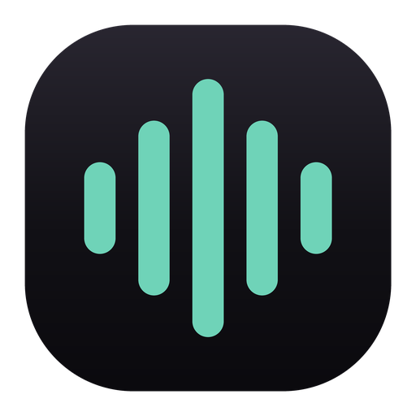
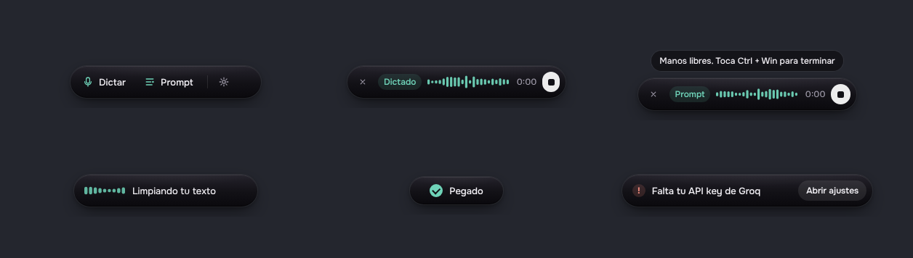
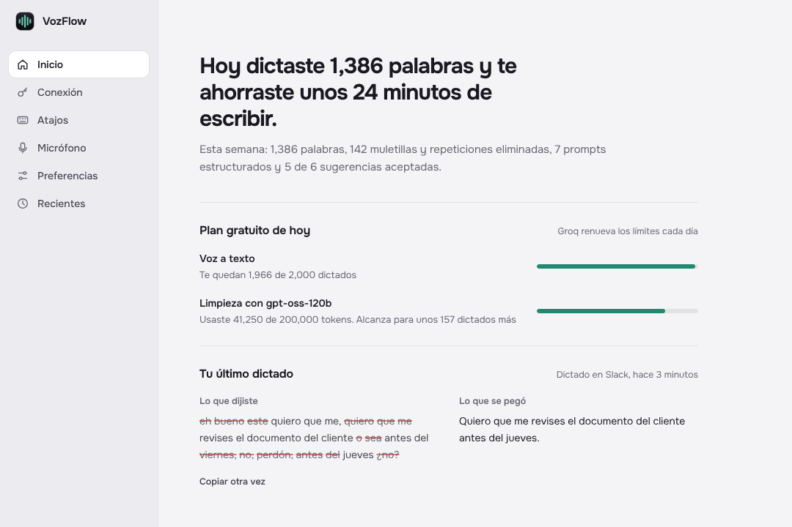
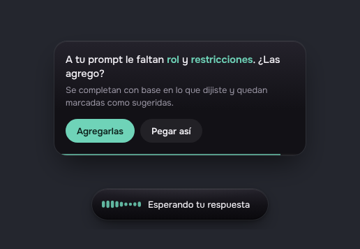
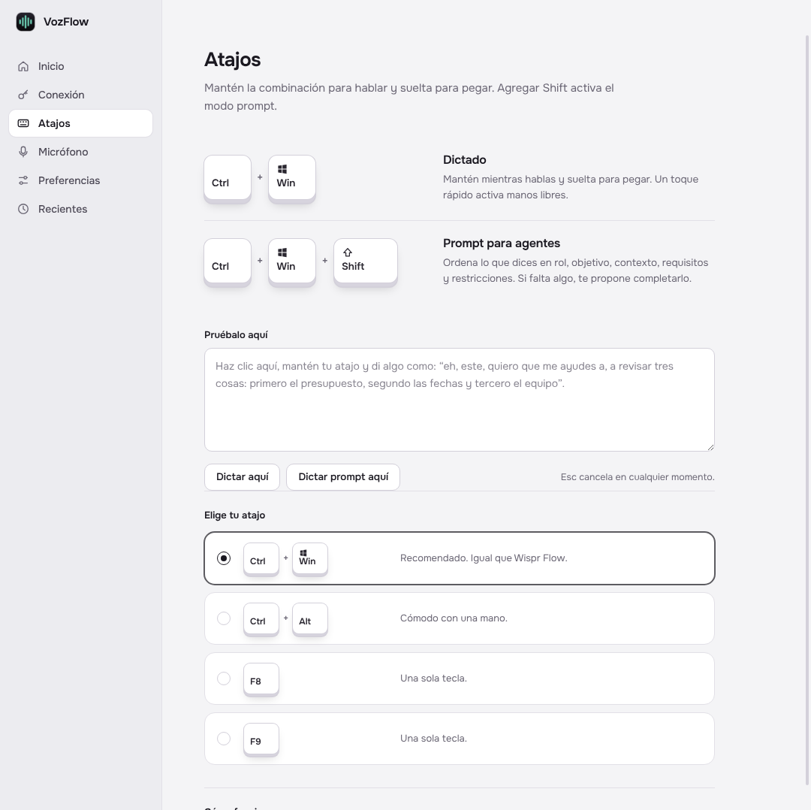
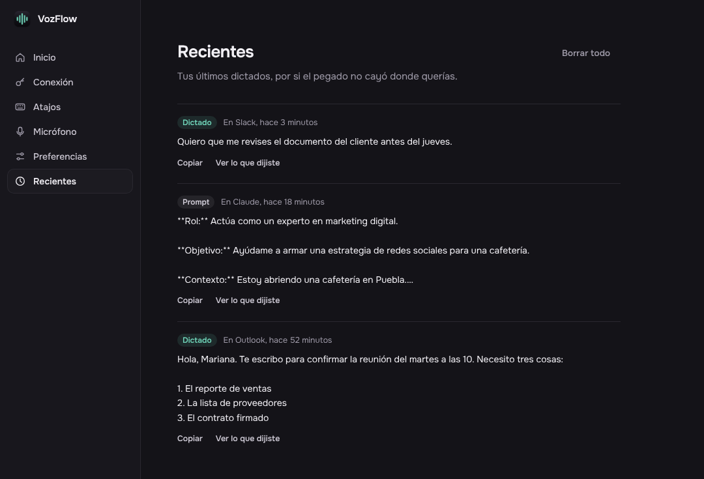
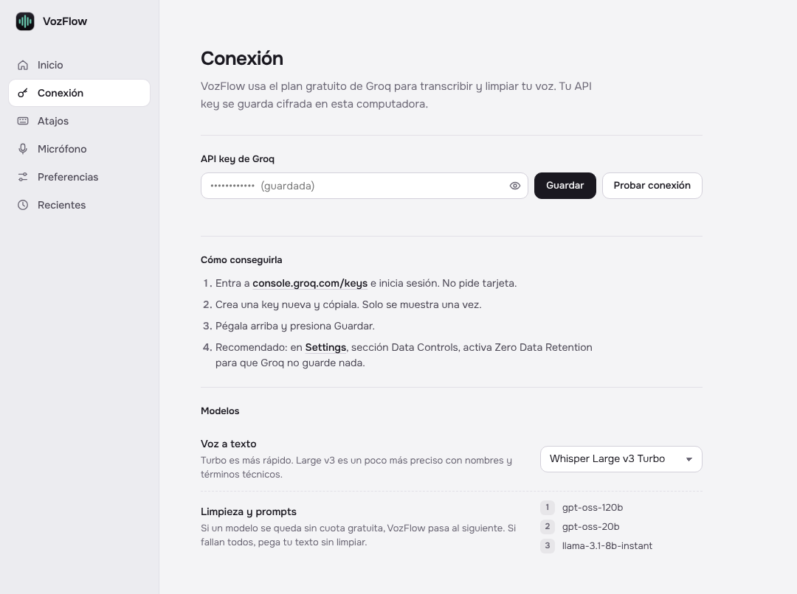
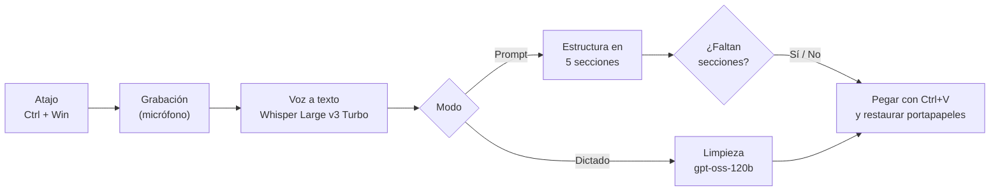

<div align="center">



# VozFlow

**Dictado por voz para Windows. Mantén `Ctrl + Win`, habla y suelta: el texto aparece limpio en la app donde tengas el cursor.**

Alternativa **gratuita y open source** a Wispr Flow, pensada para el español y para dictarle prompts a agentes de IA.



</div>

---

## ¿Qué es?

Hablar es unas tres veces más rápido que escribir, pero el dictado normal de Windows pega todo tal cual: muletillas, repeticiones, frases a medias y correcciones. VozFlow escucha lo que dices, lo transcribe y **lo reescribe como lo habrías escrito tú**:

| Lo que dices | Lo que se pega |
|---|---|
| *"eh bueno este quiero que me, quiero que me revises el documento del cliente o sea antes del viernes, no, perdón, antes del jueves ¿no?"* | Quiero que me revises el documento del cliente antes del jueves. |
| *"hola Mariana te escribo para confirmar la reunión del martes a las diez y necesito tres cosas primero el reporte de ventas segundo la lista de proveedores y tercero el contrato firmado"* | Hola, Mariana. Te escribo para confirmar la reunión del martes a las 10. Necesito tres cosas:<br>1. El reporte de ventas<br>2. La lista de proveedores<br>3. El contrato firmado |

Y con **`Ctrl + Win + Shift`**, lo que dictas se convierte en un **prompt estructurado** listo para ChatGPT, Claude, Cursor o cualquier agente.

## Características

- **Funciona en cualquier app de Windows.** Mantén el atajo, habla y suelta. El texto se pega donde esté el cursor.
- **Limpieza en español de verdad.** Quita muletillas ("eh", "este", "o sea", "¿no?"), repeticiones y arranques en falso, y resuelve autocorrecciones ("a las dos, no, perdón, a las tres" → "a las 3").
- **Listas automáticas.** Si enumeras ("primero…, segundo…"), VozFlow arma la lista.
- **Modo prompt para agentes.** Ordena lo que dices en **rol, objetivo, contexto, requisitos y restricciones**. Si te faltó alguna sección, te pregunta si la completa.
- **Manos libres.** Un toque rápido al atajo graba sin mantenerlo presionado; otro toque termina.
- **Resumen del día.** Cuántas palabras dictaste, cuánto tiempo te ahorraste, cuánto te queda del plan gratuito y una comparación de lo que dijiste contra lo que se pegó.
- **Privado por diseño.** Sin capturas de pantalla, sin cuentas, sin servidores propios. Tu API key se guarda cifrada en tu computadora.
- **Gratis.** Usa el plan gratuito de [Groq](https://groq.com), que alcanza para cientos de dictados al día.

## VozFlow vs. Wispr Flow

[Wispr Flow](https://wisprflow.ai) es una gran app comercial y fue la inspiración de este proyecto. VozFlow no está afiliado a Wispr; es una alternativa independiente con otras prioridades.

| | **VozFlow** | Wispr Flow |
|---|---|---|
| Precio | Gratis (plan gratuito de Groq) | Plan gratis limitado a 2,000 palabras por semana; Pro desde USD 12–15 al mes |
| Código | Open source (MIT) | Cerrado |
| Cuenta | No hace falta | Obligatoria |
| Español | Limpieza diseñada para español mexicano | Multilenguaje; los estilos de escritura solo funcionan en inglés |
| Prompts para agentes | Modo prompt con sugerencias de secciones faltantes | Command Mode (de pago) para editar texto seleccionado por voz |
| Contexto que se envía | Solo el nombre de la app y el título de la ventana | Puede usar contexto de pantalla (función Context Awareness) |
| Plataformas | Windows | Mac, Windows, iOS y Android |

Precios y funciones de Wispr Flow consultados en octubre de 2026; pueden cambiar.

## Capturas

**Inicio:** tu día en una frase, el plan gratuito y tu último dictado, con lo que se quitó tachado.



**Modo prompt:** si al prompt le falta una sección, la pastilla pregunta antes de pegar.



**Atajos:** las teclas se hunden cuando presionas tu atajo real, así compruebas que VozFlow lo detecta.



**Modo oscuro:** sigue el tema de Windows.



## Instalación

### Opción 1: desde el código (para desarrollar o usar en tu PC)

**Requisito:** [Node.js](https://nodejs.org/es/download) 22.12 o más nuevo (versión LTS). Solo se instala una vez.

```bash
git clone https://github.com/omonroyt/VozFlow.git
```

Después abre la carpeta `VozFlow\app` y da doble clic en **`iniciar.bat`**. La primera vez instala las dependencias (un par de minutos) y abre la app.

### Opción 2: instalador (sin Node, para cualquier computadora)

En una computadora que ya tenga el proyecto, da doble clic en **`app\crear-instalador.bat`**. Se genera `app\dist\VozFlow Setup 0.1.0.exe`. Lleva ese archivo a cualquier PC con Windows e instálalo.

> Como el instalador no está firmado digitalmente, Windows puede mostrar "Windows protegió tu PC". Elige **Más información → Ejecutar de todas formas**.

### Conecta tu API key de Groq (gratis)

1. Entra a [console.groq.com/keys](https://console.groq.com/keys) e inicia sesión. No pide tarjeta.
2. Crea una key y cópiala.
3. En VozFlow, ve a **Conexión**, pégala y presiona **Guardar**.
4. Recomendado: en la consola de Groq, en **Settings → Data Controls**, activa **Zero Data Retention** para que Groq no guarde nada.



## Cómo se usa

| Atajo | Qué hace |
|---|---|
| Mantener `Ctrl + Win` | **Dictado.** Graba mientras lo mantienes; al soltar, limpia y pega. |
| Toque rápido `Ctrl + Win` | **Manos libres.** Vuelve a tocarlo para terminar. |
| Mantener `Ctrl + Win + Shift` | **Prompt.** Ordena lo dicho en un prompt estructurado. Shift se puede agregar a mitad de la grabación. |
| `Esc` | Cancela sin pegar nada. |

El atajo se puede cambiar a `Ctrl + Alt`, `F8` o `F9` en **Atajos**. VozFlow vive en la bandeja del sistema, junto al reloj; desde ahí lo abres o lo cierras.

### Ejemplo del modo prompt

Dices: *"eh quiero que actúes como un experto en marketing digital, este, y que me ayudes a armar una estrategia para redes sociales de una cafetería que estoy abriendo en Puebla, tiene que ser de tres meses con calendario y presupuesto y no me recomiendes TikTok"*

Se pega:

```markdown
**Rol:** Actúa como un experto en marketing digital.

**Objetivo:** Ayúdame a armar una estrategia de redes sociales para una cafetería.

**Contexto:** Estoy abriendo una cafetería en Puebla.

**Requisitos:**
- La estrategia debe cubrir tres meses.
- Incluye un calendario de publicaciones.
- Incluye un presupuesto.

**Restricciones:**
- No recomiendes TikTok.
```

VozFlow solo reorganiza lo que dijiste: **nunca ejecuta ni responde** lo que dictas. Si aceptas completar secciones faltantes, quedan marcadas como *(sugerido)* para que las revises.

## Cómo funciona



1. **Atajo global.** [`uiohook-napi`](https://github.com/SnosMe/uiohook-napi) detecta cuándo mantienes y sueltas las teclas.
2. **Grabación.** El micrófono solo se abre mientras grabas. El audio no se guarda en disco.
3. **Voz a texto.** El audio va a Whisper en Groq. Se filtran las frases que Whisper inventa en silencio ("Subtítulos realizados por la comunidad de Amara.org").
4. **Limpieza o estructura.** Un LLM en Groq limpia el texto o arma el prompt. Si un modelo se queda sin cuota, pasa al siguiente: `gpt-oss-120b` → `gpt-oss-20b` → `llama-3.1-8b-instant`. Si todos fallan, se pega la transcripción sin limpiar; nunca te quedas sin tu texto.
5. **Pegado.** Copia el resultado, simula `Ctrl + V` y devuelve al portapapeles lo que tenías antes.

### Límites del plan gratuito de Groq

| Uso | Modelo | Límite diario aproximado |
|---|---|---|
| Voz a texto | `whisper-large-v3-turbo` | 2,000 peticiones y unas 8 horas de audio |
| Limpieza | `openai/gpt-oss-120b` | 1,000 peticiones y 200,000 tokens (unos 200 dictados) |
| Respaldo 1 | `openai/gpt-oss-20b` | 1,000 peticiones y 200,000 tokens |
| Respaldo 2 | `llama-3.1-8b-instant` | 14,400 peticiones y 500,000 tokens |

Los límites se renuevan cada día y Groq no cobra nada si los alcanzas; simplemente responde que se agotó la cuota. Si algún día prefieres pagar, el uso intenso (unos 150 dictados al día) cuesta menos de USD 3 al mes. Límites consultados en octubre de 2026.

## Privacidad

- **Tu API key** se guarda cifrada con DPAPI de Windows en `%APPDATA%\VozFlow`, fuera del proyecto. Nunca se sube al repositorio y no se puede descifrar en otra computadora.
- **El audio** solo se envía a Groq para transcribirlo y no se guarda en tu disco.
- **El contexto** se limita al nombre de la app activa y al título de la ventana, para dar el formato correcto. Se puede desactivar en **Preferencias**. VozFlow nunca toma capturas de pantalla.
- **Tu historial y tus estadísticas** se quedan en tu computadora.
- **Sin telemetría.** VozFlow no tiene servidores propios ni analíticas.

## Estructura del proyecto

```
VozFlow/
├── app/
│   ├── iniciar.bat            Instala lo necesario (la primera vez) y abre VozFlow
│   ├── crear-instalador.bat   Genera el instalador .exe en app/dist
│   ├── assets/                Íconos de la app y de la bandeja
│   └── src/
│       ├── main/
│       │   ├── main.js        Orquesta todo: ventanas, bandeja y flujo de dictado
│       │   ├── hotkeys.js     Atajos globales: mantener, tocar, Shift y Esc
│       │   ├── groq.js        Whisper y LLM con cadena de modelos de respaldo
│       │   ├── prompts.js     Prompts de limpieza, modo prompt y sugerencias
│       │   ├── context.js     Nombre de la app activa (Windows), sin capturas
│       │   ├── paste.js       Pegar y restaurar el portapapeles
│       │   └── store.js       Ajustes, key cifrada, historial, cuota y estadísticas
│       ├── shared/diff.js     Compara lo dicho con lo pegado (palabras quitadas)
│       ├── preload/           Puente seguro entre Electron y las ventanas
│       └── renderer/
│           ├── pill/          La pastilla flotante: grabación, onda y sugerencias
│           └── settings/      La ventana principal: Inicio, Conexión, Atajos…
├── docs/screenshots/          Capturas de este README
└── DECISIONES.md              Investigación y decisiones de diseño del proyecto
```

## Desarrollo

```bash
cd app
npm install
npm start
```

- **Afinar la limpieza:** todo el comportamiento del LLM está en [`app/src/main/prompts.js`](app/src/main/prompts.js), con ejemplos en español.
- **Cambiar el color de la app:** edita `--acento` en [`app/src/renderer/shared/tokens.css`](app/src/renderer/shared/tokens.css).
- **Capturas automáticas de todas las pantallas:** `VOZFLOW_SHOTS=./capturas npm start` (en PowerShell: `$env:VOZFLOW_SHOTS="capturas"; npm start`).
- **Usar la key desde una variable de entorno:** define `GROQ_API_KEY` y VozFlow la usa en lugar de la guardada.

Construido con [Electron](https://www.electronjs.org), HTML, CSS y JavaScript, sin frameworks ni empaquetadores.

## Pendientes

- [ ] Command Mode: seleccionar texto y editarlo por voz ("hazlo más corto")
- [ ] Diccionario personal para nombres y términos técnicos
- [ ] Aprender de las correcciones que haces después de pegar
- [ ] Versión para macOS
- [ ] Instalador firmado

¿Ideas o errores? Abre un [issue](https://github.com/omonroyt/VozFlow/issues).

## Créditos

- Inspirado en [Wispr Flow](https://wisprflow.ai). VozFlow no está afiliado a Wispr.
- [Handy](https://github.com/cjpais/Handy) y [OpenWhispr](https://github.com/OpenWhispr/openwhispr), dos proyectos open source (MIT) que sirvieron como referencia de arquitectura.
- Transcripción y LLM por [Groq](https://groq.com). Modelos: Whisper de OpenAI, gpt-oss de OpenAI y Llama de Meta.
- Tipografía [Onest](https://github.com/simpals/onest) (SIL Open Font License 1.1).

## Licencia

[MIT](LICENSE) © 2026 Oscar Monroy. Puedes usarlo, modificarlo y distribuirlo libremente.
